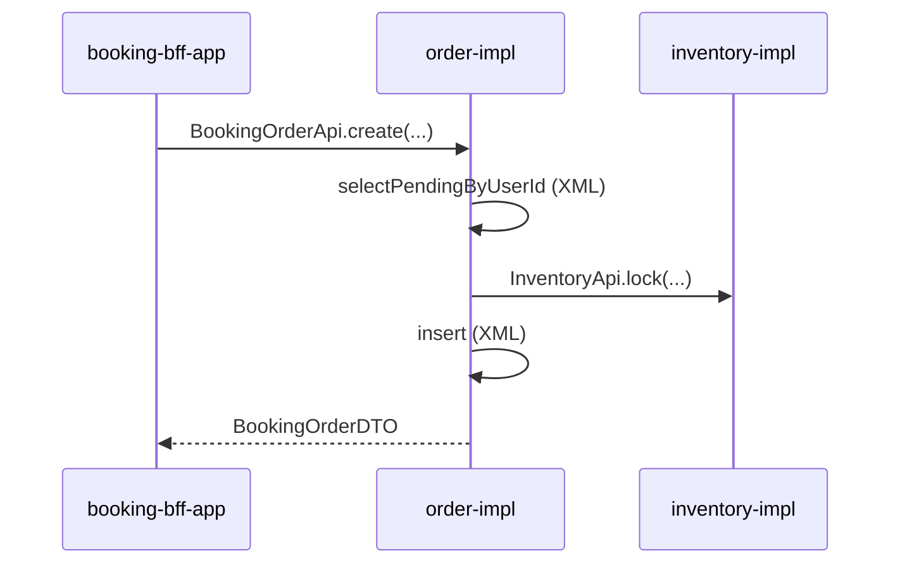

# DD-STORY-GOLDEN-001-booking-order-create

| 字段 | 值 |
|------|-----|
| Story | STORY-GOLDEN-001-booking-order-create（范本，非真实 Story） |
| 迭代 | GOLDEN（范本） |
| 服务标识 | `booking-order` |
| 状态 | 已确认（范本） |
| 复杂度 | 中等 |

> **范本说明**：演示停车域详设结构与粒度，含 ORM 最佳实践。勿将 `_golden` 路径当作真实迭代落盘位置。

## 1. 概述

### 1.1 目标与范围

- **目标**：车主选定车位与时段后创建预约单（待支付）
- **非目标**：支付回调、库存锁定细节（独立 Story）

### 1.2 架构上下文

- **服务/模块**：`booking-bff-app`（HTTP）→ `order-api` / `order-impl`
- **集成**：BFF 调 `BookingOrderApi`；order 调 `InventoryApi` 锁定车位（V1 同 JVM）
- **分层**：Controller → `BookingOrderApi` → `BookingOrderApiImpl` → Facade → Service → Mapper

---

## 2. AC / BR 解析摘要

| AC/BR | 资源/动作 | 异常与边界 |
|-------|-----------|------------|
| AC-01 | POST 创建预约单 | 车位不可用 → 1601 |
| BR-01 | 同一用户同时仅一条待支付单 | 唯一性校验 |

---

## 3. AC → 契约映射（总表）

| AC | 契约类型 | 落点摘要 | 备注 |
|----|----------|----------|------|
| AC-01 | OpenAPI + 类骨架 | BFF `BookingOrderController#create` | |
| AC-01 | 领域模型 + 持久化 | `BookingOrderDO` + Mapper/XML | 见 §6.2 |
| BR-01 | 持久化 | `selectPendingByUserId`（XML） | 非主键查询 |

---

## 4. 领域模型设计

### 4.1 核心概念与术语

| 概念 | 类型 | 定义 | 词表对齐 |
|------|------|------|----------|
| 预约单 | 聚合根 | 车主对某车位时段的预订记录 | 预约单 |

### 4.3 状态与生命周期

| 状态 | 进入条件 | 退出条件 | 关联 AC/BR |
|------|----------|----------|------------|
| PENDING_PAYMENT | 创建成功 | 支付成功 / 取消 / 超时 | AC-01 |

---

## 5. 接口设计

### 5.1 AC → API 映射表

| AC | Method | Path | 说明 |
|----|--------|------|------|
| AC-01 | POST | `/api/v1/booking/app/orders` | 创建预约单 |

---

## 6. 持久化与数据模型

### 6.1 schema 变更摘要

- 文件：`docs/schema/booking-order/schema.md`
- 表：`booking_order`（`id` PK、`user_id`、`parking_space_id`、`status`、`created_at`）
- 索引：`uk_user_pending`（`user_id`, `status`）支撑 BR-01

### 6.2 数据访问（ORM 约定）

| AC/BR | Mapper 方法 | XML `id` | 方式 | 说明 |
|-------|-------------|----------|------|------|
| AC-01 | `insert` | `insert` | XML | 创建预约单 |
| AC-01 | `selectById` | — | **MyBatis Plus** | 创建后回读 |
| BR-01 | `selectPendingByUserId` | `selectPendingByUserId` | **XML** | 条件查询，禁止 Wrapper |

```text
booking-order-impl/
  infrastructure/dataobject/BookingOrderDO.java
  infrastructure/mapper/BookingOrderMapper.java   # extends BaseMapper<BookingOrderDO>
  resources/mapper/BookingOrderMapper.xml         # insert、selectPendingByUserId
```

**禁止**：`@Select` 注解 SQL；`LambdaQueryWrapper` 查待支付单。

---

## 7. 时序图



---

## 8. 代码骨架

### 8.2 AC → 代码追溯表

| AC | 模块路径 | 类/方法 | 操作 |
|----|----------|---------|------|
| AC-01 | `booking-bff-app/.../BookingOrderController` | `create(...)` | 新建 |
| AC-01 | `order-impl/.../BookingOrderMapper` | `insert` / `selectById` | 新建 |
| BR-01 | `order-impl/.../BookingOrderMapper` | `selectPendingByUserId` | 新建（XML） |

### 8.3 新建

| 文件 | 类/方法签名 | 职责 |
|------|-------------|------|
| `BookingOrderMapper.java` | `extends BaseMapper<BookingOrderDO>` | 主键 CRUD |
| `BookingOrderMapper.java` | `BookingOrderDO selectPendingByUserId(Long userId)` | BR-01 唯一性 |
| `BookingOrderMapper.xml` | `<insert id="insert">`、`<select id="selectPendingByUserId">` | 非主键 SQL |

---

## 9. 测试策略

- 单元：`BookingOrderServiceTest` Mock `BookingOrderMapper`
- API：`BookingOrderControllerTest` Mock `BookingOrderApi`

---

## 10. 风险、开放问题与推断项

| 类型 | 内容 |
|------|------|
| 风险 | BR-01 并发下需 DB 唯一索引兜底 |

---

## 11. 变更记录

| 日期 | 变更 | 作者 |
|------|------|------|
| 2026-07-26 | 初版范本；补充 ORM 最佳实践 §6.2 | AI |
