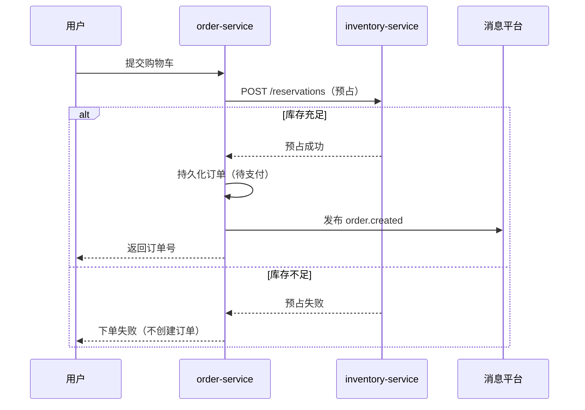

# HLD-EPIC-GOLDEN-001-order-checkout

| 字段 | 值 |
|------|-----|
| Epic | EPIC-GOLDEN-001-order-checkout（范本，非真实 Epic 文件） |
| slug | `order-checkout` |
| 状态 | 已确认（范本） |
| 复杂度 | 中等 |

> **范本说明**：演示多微服务场景下 HLD 结构与粒度。勿将 `_golden` 路径当作真实 Epic 落盘位置。  
> **禁止**：完整 OpenAPI YAML、`properties` 级字段表。

## 1. 背景与范围

### 1.1 目标

- 用户从购物车提交订单，系统完成库存预占并创建待支付订单
- 订单与库存分属不同微服务，通过同步 API + 异步事件协作

### 1.2 非目标

- 支付渠道对接与支付回调（独立 Epic）
- 促销算价引擎细节
- 全字段 OpenAPI（留给详设）

---

## 2. 系统上下文

| 系统 / 子产品 | 一句话定位 | 本 Epic 角色 |
|---------------|-----------|--------------|
| **交易中台** | 订单生命周期 | 承载 `order-service` |
| **库存中心** | 库存预占与扣减 | 承载 `inventory-service` |
| **消息平台** | 企业 MQ | 投递 `order.created` 等事件 |

```text
用户 → 交易中台(order-service) → 库存中心(inventory-service)
                ↓
           消息平台(MQ)
```

---

## 3. 系统/服务边界

| 服务 | 职责 | 数据写归属 |
|------|------|------------|
| `order-service` | 订单创建、状态机（待支付/已取消） | `order` 表 |
| `inventory-service` | 库存预占、释放预占 | `stock_reservation` 表 |

---

## 4. 集成矩阵

| 调用方 | 被调方 | 模式 | 粗接口 / 事件 | 说明 |
|--------|--------|------|---------------|------|
| `order-service` | `inventory-service` | sync REST | `POST /inventory/v1/reservations` | 下单时预占库存 |
| `order-service` | MQ | async | `order.created` | 订单创建成功后通知下游 |
| `inventory-service` | MQ | async | `inventory.reservation.failed` | 预占失败告警（可选） |

---

## 5. 关键流程

### 5.1 用户下单（主路径）



---

## 6. 数据主权

| 数据 / 实体 | 写归属 | 只读消费方 | 同步策略 |
|-------------|--------|------------|----------|
| Order（订单） | `order-service` | 支付服务、履约服务 | 事件 `order.created` |
| StockReservation（预占） | `inventory-service` | `order-service`（查询预占结果） | 同步 API |

---

## 7. 粗 API / 事件契约

### 7.1 粗 API 清单

| 服务 | Method | Path（骨架） | 说明 |
|------|--------|--------------|------|
| order-service | POST | `/orders/v1` | 创建订单 |
| order-service | GET | `/orders/v1/{orderId}` | 查询订单状态 |
| inventory-service | POST | `/inventory/v1/reservations` | 预占库存 |
| inventory-service | DELETE | `/inventory/v1/reservations/{id}` | 释放预占（取消订单） |

### 7.2 事件

| 事件类型 | 生产者 | 消费者 | 携带主键 |
|----------|--------|--------|----------|
| `order.created` | order-service | 支付、履约 | `orderId`, `userId` |

---

## 8. NFR 约束

| 维度 | 约束 |
|------|------|
| 性能 | 下单主路径 P99 < 500ms |
| 可用性 | 交易链路 99.9% |
| 安全 | 内网 mTLS；用户身份经网关 JWT 传入 |
| 可观测 | 全链路 Trace；`orderId` 贯穿 span |

---

## 9. 关键 ADR

| 决策 | 选项 | 结论 | 原因 |
|------|------|------|------|
| 库存预占时机 | 异步预占 / 同步预占 | **同步预占** | 库存不足则不创建订单，避免补偿复杂度 |
| 预占失败处理 | 创建待处理订单 / 直接失败 | **直接失败** | 用户体验简单；不进入支付 |
| 订单与库存一致性 | 2PC / Saga / 同步+本地事务 | **同步调用 + order 本地事务** | MVP 阶段够用；支付 Epic 再引入 Saga |

---

## 10. 建议 Story 列表

| 建议序号 | 标题 | 一句话意图 |
|----------|------|------------|
| S-01 | 创建订单 API | 用户提交购物车生成待支付订单并返回订单号 |
| S-02 | 库存预占集成 | order 同步调用 inventory 预占，失败则不下单 |
| S-03 | 订单状态查询 | 用户按订单号查询待支付/已取消状态 |
| S-04 | 订单创建事件 | 订单成功后发布 `order.created` 供下游消费 |

---

## 11. 风险与开放问题

| 类型 | 内容 |
|------|------|
| 风险 | 支付 Epic 未设计前，订单取消与预占释放的完整 Saga 未闭合 |
| 开放问题 | 促销算价是否在本 Epic 内——当前标为非目标 |

---

## 12. 变更记录

| 日期 | 变更 | 作者 |
|------|------|------|
| 2026-07-26 | 初版 Golden 范本 | high-level-design |
