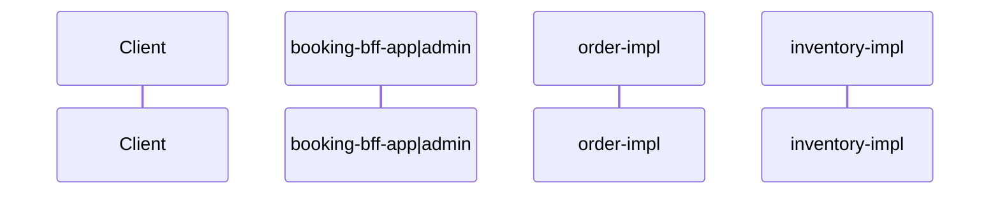

# 详设：DD-{Story编号}-{slug}

| 字段 | 值 |
|------|-----|
| Story | [STORY-{迭代}-{序号}-{slug}](../requirements/{迭代}/STORY-*.md) |
| 迭代 | |
| 服务标识 | `booking-order` / `booking-inventory` / `booking-bff-app` / `booking-bff-admin`（见 system-landscape） |
| 状态 | 草稿 / 评审中 / 已确认 |
| 复杂度 | 简单 / 中等 / 高复杂 |

## 1. 概述

### 1.1 目标与范围

- **目标**：
- **非目标**：

### 1.2 架构上下文

- **服务/模块**：`booking-bff-app` / `booking-bff-admin` / `order-api` + `order-impl` / `inventory` / `adapter` / `common`
- **集成**：V1 同 JVM `XxxApi`；外部：支付系统、iam-server、封闭式车场（见 system-landscape）
- **分层**：BFF（Controller）→ `*-api`（XxxApi + DTO）→ `*-impl`（Provider → Facade → Service → infrastructure）
- **校验职责落点**（Story §2.3）：见 [bff-domain-boundary-guide.md](../references/bff-domain-boundary-guide.md)

| Story §2.3 | 守卫 / 领域 | §8 落点 |
|------------|-------------|---------|
| | | |

### 1.3 轻量 ADR（若有）

| 决策 | 选项 | 结论 | 原因 |
|------|------|------|------|
| | | | |

---

## 2. AC / BR 解析摘要

| AC/BR | 资源/动作 | 异常与边界 |
|-------|-----------|------------|
| AC-01 | | |
| BR-01 | | |

---

## 3. AC → 契约映射（总表）

| AC | 契约类型 | 落点摘要 | 备注 |
|----|----------|----------|------|
| AC-01 | 领域模型 / OpenAPI / 类骨架 / N/A | | |

---

## 4. 领域模型设计

### 4.1 核心概念与术语

| 概念 | 类型 | 定义 | 词表对齐 |
|------|------|------|----------|
| | | | |

### 4.2 实体关系 / 类图（若适用）

> §4.1 有多个概念时，用类图标明聚合根、实体与**查询视图**（查询视图无独立状态机）。

```mermaid
classDiagram
```

### 4.3 {业务对象}有哪些状态（{EnglishName}）（若适用）

> **§4.3 标题（必读）**  
> - **主标题用白话问句或陈述**，让读者一眼知道「谁的状态」；英文类名放括号内。  
> - **技术信息**（聚合根/实体、枚举名、表字段、查询视图类名）写在标题下 **「> 技术：…」** 引导句，不堆进主标题。  
> - **禁止**无主体的「状态与生命周期」；**禁止**把 `Story BR-xx`、「查询视图」「查询过滤」等术语作主标题。  
> - 本 Story **只读**状态时，标题加「（本 Story 只读）」；负责迁移时在 §4.3.1 表内写进入/退出条件。  
> - §4.1 有**查询视图**时，全量状态写 **§4.3.1**，「算不算某业务子集」写 **§4.3.2**（见下方范例）。

> **技术**：{聚合根/实体}；状态枚举 `{EnumName}`；持久化 `{table}.{column}`（若已知）。

#### 4.3.1 {业务对象}全量状态

| 状态（枚举） | 中文 label | 进入条件 | 退出条件 | 关联 AC/BR |
|--------------|------------|----------|----------|------------|
| | | | | |

> 只读 Story 可省略「进入/退出条件」，改列「本 Story 是否迁移」。

#### 4.3.2 哪些{业务对象}算「{业务说法}」（若适用）

> **技术**：查询视图 `{ViewName}` / 读模型；筛选规则对齐 Story **BR-xx**（编号写此处，不写进主标题）。

| {业务对象}状态 | 计入「{业务说法}」 | 说明 | 关联 AC/BR |
|----------------|-------------------|------|------------|
| | | | |

**标题范例**

| 推荐（主标题） | 不推荐 |
|----------------|--------|
| `### 4.3 预约单有哪些状态（BookingOrder）（本 Story 只读）` | `### 4.3 状态与生命周期` |
| `#### 4.3.2 哪些预约单算「进行中」` | `#### 4.3.2 进行中预约查询过滤（查询视图 · Story BR-01）` |
| `### 4.3 车位有哪些状态（ParkingSpace）（本 Story 只读）` | `### 4.3 状态与生命周期（本 Story 只读）` |
| `#### 4.3.2 哪些车位算「可售/可推荐」` | `#### 4.3.2 可售车位筛选规则（查询视图）` |

### 4.4 AC → 领域对象映射

> **§4 概念 ≠ 必有 Java 领域类**；须填 **代码落点（§8）** 与 **领域厚度**（薄/中/厚）。规则见 [domain-model-guide.md](../references/domain-model-guide.md)「务实领域模型」。

| AC | 领域概念 | 代码落点（§8） | 领域厚度 | 职责 / 不变量 |
|----|----------|----------------|----------|---------------|
| AC-01 | 预约单（文档） | `BookingOrderDO` / 可选 `domain.model.BookingOrder` | 薄 | |

---

## 5. 接口设计（若 Story 含 HTTP）

### 5.1 AC → API 映射表

| AC | Method | Path | 说明 |
|----|--------|------|------|
| | | | |

### 5.2 OpenAPI 增量摘要

- 文件：`docs/api/{服务标识}/openapi.yaml`
- **变更摘要**：（须用户确认后合并）
- **约定**：[openapi-conventions.md](../references/openapi-conventions.md)

### 5.3 错误码（若适用）

| 场景 | HTTP | 业务码 | 用户可见 message | OpenAPI example 名 |
|------|------|--------|------------------|-------------------|
| | | | | `ErrorXxx` |

### 5.4 OpenAPI 自动化测试自检

- [ ] `servers` 含本地与相对路径
- [ ] `securitySchemes` + 需鉴权 operation 已标注
- [ ] 每 operation 有成功 + 失败 `examples`
- [ ] Story 失败类 AC ↔ `components/examples` 可追溯
- [ ] §9 测试策略注明 MockMvc / Newman / springdoc 计划

---

## 6. 持久化与数据模型（若适用）

### 6.1 schema 变更摘要

- 文件：`docs/schema/{服务标识}/schema.md`
- 表 / 索引：
- **DDL**：每张表须 `CREATE TABLE`（新表）或 `ALTER TABLE`（增量）；见 [schema-conventions.md](../references/schema-conventions.md)

### 6.2 数据访问（ORM 约定）

| 场景 | 落点 | 说明 |
|------|------|------|
| 新建写入 | `*CommandService` 注入 `SnowflakeIdGenerator` | `INSERT` 前 `do.setId(idGenerator.nextId())`；依赖 `com.hema:common-core`（`${hema-common.version}`，与 hema-common 根 POM 对齐） |
| 主键查询 | Mapper 继承 `BaseMapper<DO>` | 允许 `selectById` 等；排除已删行须在本表或 XML 写明 |
| 业务删除 | Mapper XML（如 `softDeleteById`） | `UPDATE ... SET deleted=1, deleted_at=NOW()`；**禁止**业务路径 `deleteById` 物理删 |
| 条件查询、联表、分页、批量更新 | `resources/mapper/**/*.xml` | Mapper 接口只声明方法签名，SQL **仅** 写 XML；默认 `AND deleted = 0` |
| 禁止 | `@Select` 等注解 SQL、`QueryWrapper` 条件查询 | 见 `rules/mybatis-conventions.md` |

**标准列 / 主键**：见 [schema-conventions.md](../references/schema-conventions.md) §1.2（雪花 ID、软删除）。

**§8 追溯**：每条涉及持久化的 AC 须列出 Mapper 方法名与 XML `id` 对应关系；写操作须体现 `SnowflakeIdGenerator`。

---

## 7. 时序图（跨服务 / MQ 时必填）



---

## 8. 代码骨架（feature-coding 权威来源）

> 推导规则见 [code-skeleton-guide.md](../references/code-skeleton-guide.md)。只写类名、公开方法签名、修改清单；不写方法体、不写测试类名。

### 8.1 依赖方向

```text
booking-bff-app / booking-bff-admin  →  *-api
*-impl       →  *-api、booking-common
```

### 8.2 AC → 代码追溯表

| AC | 模块路径 | 类/方法 | 操作 |
|----|----------|---------|------|
| AC-01 | | | 新建 |

### 8.3 新建

| 文件 | 类/方法签名 | 职责 |
|------|-------------|------|
| | | |

### 8.4 增量修改清单

| 文件 | 修改点 |
|------|--------|
| | |

---

## 9. 测试策略

- 单元：`ServiceTest` + Mockito
- API：`@WebMvcTest` + MockMvc（断言 `Result.code` 与 AC 文案）
- 集成：`@SpringBootTest`（按需）
- 契约（可选）：Postman/Newman 导入 `docs/api/{服务标识}/openapi.yaml`；断言 `body.code === 200`

---

## 10. 风险、开放问题与推断项

| 类型 | 内容 |
|------|------|
| 风险 | |
| 开放问题 | |
| [AI推断] | |

---

## 11. 变更记录

| 日期 | 变更 | 作者 |
|------|------|------|
| | | |
