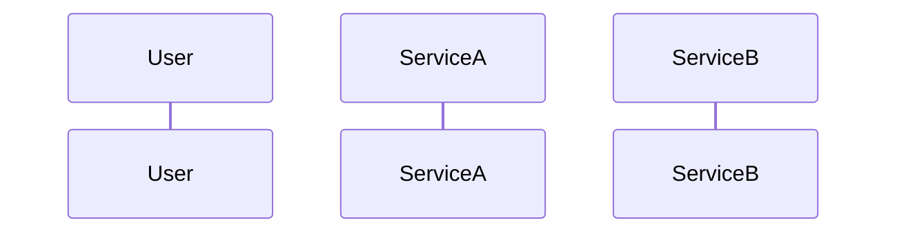

# 概设：HLD-EPIC-{slug}

| 字段 | 值 |
|------|-----|
| Epic | [EPIC-{slug}](../../requirements/epics/EPIC-{slug}.md) |
| slug | |
| 状态 | 草稿 / 评审中 / 已确认 |
| 复杂度 | 简单 / 中等 / 高复杂 |

## 1. 背景与范围

### 1.1 目标

-

### 1.2 非目标

-

---

## 2. 系统上下文

> C4 Context：本 Epic 涉及哪些系统/子产品、外部集成方。

| 系统 / 子产品 | 一句话定位 | 本 Epic 角色 |
|---------------|-----------|--------------|
| | | |

```text
（可选 ASCII 或 Mermaid Context 图）
```

---

## 3. 系统/服务边界

> Container 级：系统内微服务或模块划分、职责一句话。

| 服务 / 模块 | 职责 | 数据写归属 |
|-------------|------|------------|
| | | |

---

## 4. 集成矩阵

| 调用方 | 被调方 | 模式 | 粗接口 / 事件 | 说明 |
|--------|--------|------|---------------|------|
| | | sync REST / async MQ / … | | |

---

## 5. 关键流程

> 1～3 条主旅程；主成功路径 + 关键异常（粗粒度）。

### 5.1 {旅程名称}



---

## 6. 数据主权

| 数据 / 实体 | 写归属（服务） | 只读消费方 | 同步策略（若有） |
|-------------|----------------|------------|------------------|
| | | | |

---

## 7. 粗 API / 事件契约

> **仅**资源名 + 主要操作 + sync/async；**不写**全字段 OpenAPI。

### 7.1 粗 API 清单

| 服务 | Method | Path（骨架） | 说明 |
|------|--------|--------------|------|
| | POST | `/...` | |

### 7.2 事件 / 消息（若有）

| Topic / 事件类型 | 生产者 | 消费者 | 携带主键（概念级） |
|------------------|--------|--------|-------------------|
| | | | |

---

## 8. NFR 约束

| 维度 | 约束 |
|------|------|
| 性能 | |
| 可用性 | |
| 安全 / 合规 | |
| 可观测 | |

---

## 9. 关键 ADR

| 决策 | 选项 | 结论 | 原因 |
|------|------|------|------|
| | | | |

---

## 10. 建议 Story 列表

> 供 `story-splitting` 消费；**不含** AC/BR 正文。

| 建议序号 | 标题 | 一句话意图 |
|----------|------|------------|
| S-01 | | |

---

## 11. 风险与开放问题

| 类型 | 内容 |
|------|------|
| 风险 | |
| 开放问题 | |
| [AI推断] | |

---

## 12. 变更记录

| 日期 | 变更 | 作者 |
|------|------|------|
| | | |
