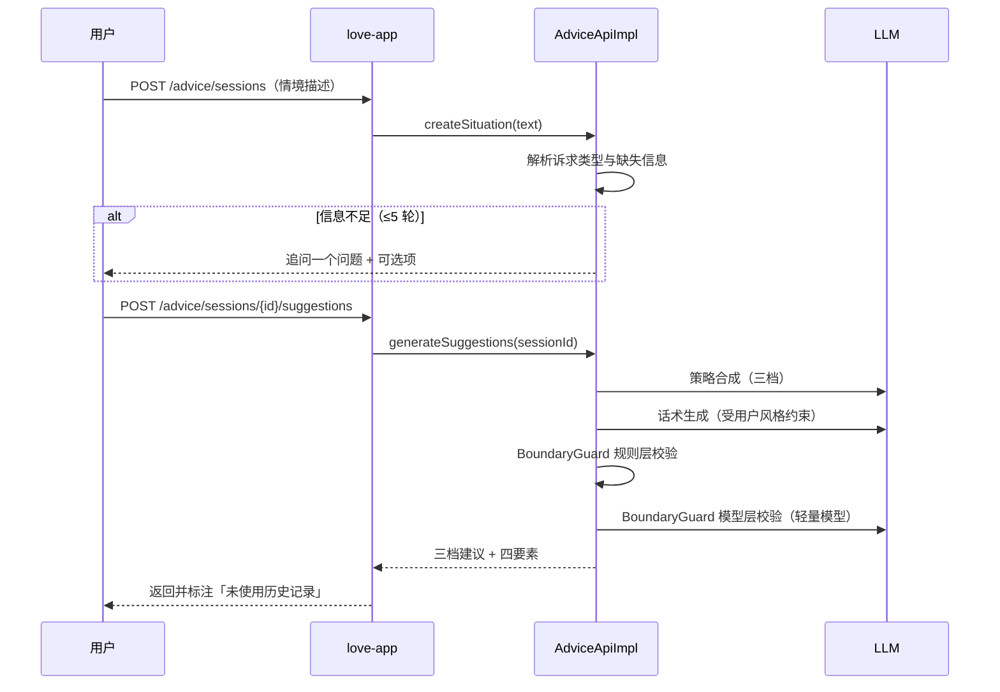
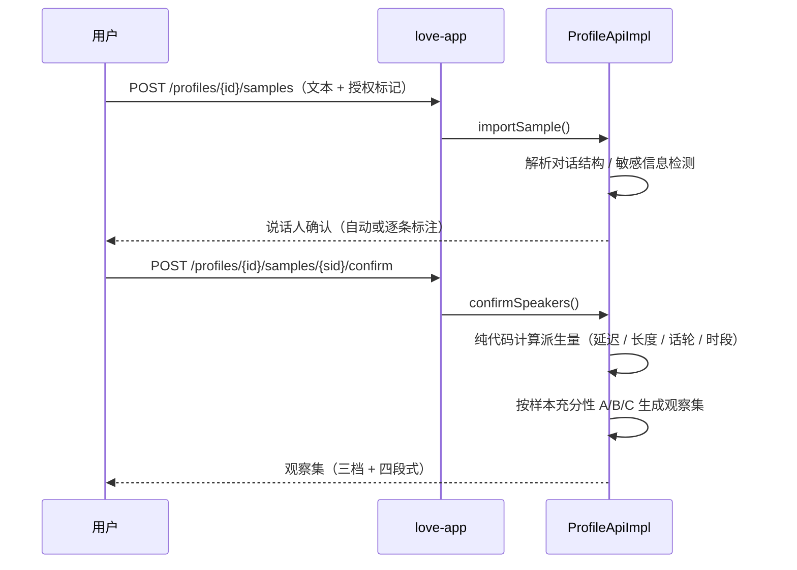
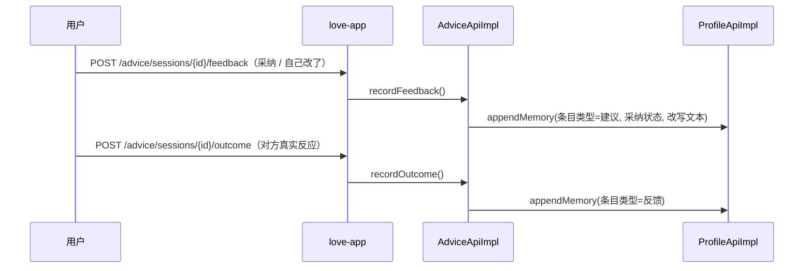

# 概设：HLD-EPIC-love-forecast

| 字段 | 值 |
|------|-----|
| Epic | [PRD-EPIC-love-forecast](../../requirements/epics/PRD-EPIC-love-forecast.md)（未建独立 Epic 卡） |
| 需求上游 | [JSD-EPIC-love-forecast](../../requirements/epics/JSD-EPIC-love-forecast.md)（已确认，3 旅程 / 20 阶段 / 80 场景） |
| slug | `love-forecast` |
| 状态 | 草稿 |
| 复杂度 | 中等（单域后端，但核心链路含 LLM 生成与多层校验） |
| 迭代 | 2026-S01 |

## 1. 背景与范围

### 1.1 目标

| # | 目标 | 验收指向 |
|---|------|---------|
| G1 | 用户不导入任何记录，也能在 3 分钟内拿到三档可发建议 | J1 / SC-J1-10～SC-J1-21 |
| G2 | 有历史记录时，建议能引用可复算的行为观察作为依据 | J2 / SC-J2-10～SC-J2-18 |
| G3 | 所有输出不越界：不做人格判断、不给类型标签、不给单一动机结论 | 规范 §4；SC-J1-18、SC-J1-26 |
| G4 | 用户数据完全隔离，可查看、可删除、可导出 | J3 / SC-J3-01～SC-J3-25 |

### 1.2 非目标

沿用 JSD §5 与 PRD §6.2，共 12 项：自动代聊、对方视角、多人关系、恋爱匹配、心理诊断、社区、截图 OCR、语音、对方客户端、咨询师撮合、商业化、运营后台。

---

## 2. 系统上下文

| 系统 / 子产品 | 一句话定位 | 本 Epic 角色 |
|---------------|-----------|--------------|
| **love-forecast 后端**（本仓库） | 业务 API + LLM 编排 + 数据存储 | 全部新建 |
| **Web 前端**（另仓） | 页面与交互 | 消费本仓库 OpenAPI；不直接调模型 |
| **LLM 供应商** | 对话生成与越界判定 | 外部依赖，经 Spring AI 抽象层调用，可替换 |
| **邮件服务** | 登录验证码 | 外部依赖，只发验证码 |

```text
Web 前端（另仓）
     │ HTTPS
     ▼
┌──────────────────────────────────────────┐
│ love-forecast 后端（单体单 jar）          │
│   love-app ──► love-profile              │
│      │      └► love-advice ──► LLM ──────┼──► 外部
│      └───────────────────────► 邮件服务 ──┼──► 外部
└──────────────────────────────────────────┘
```

---

## 3. 系统/服务边界

| 服务 / 模块 | 职责 | 数据写归属 |
|-------------|------|------------|
| `love-app` | 唯一对外 HTTP；JWT 鉴权；统一响应封装；Flyway 迁移 | 无业务表（仅 `flyway_schema_history`） |
| `love-profile` | 关系档案、沟通样本、观察集、记忆条目；导入解析与派生量计算 | `profile_*` 全部表 |
| `love-advice` | 情境解析、策略合成、话术生成、越界校验、模拟对话 | `advice_*` 全部表 |
| `love-common` | `Result` / `PageResult` / `BizException` / `ErrorCode` / 雪花 ID | 无 |

**边界硬约束**：

- 只有 `love-app` 含 Controller；`love-advice` 不得直接读 `profile_*` 表。
- `love-profile` 不得调用 `AdviceApi`（避免环）。
- LLM 调用只发生在 `love-advice`。
- 派生量计算（延迟分位数、长度分布、话轮结构、时段占比）在 `love-profile` 内用纯代码完成，不经 LLM。

---

## 4. 集成矩阵

| 调用方 | 被调方 | 模式 | 粗接口 | 说明 |
|--------|--------|------|--------|------|
| Web 前端 | `love-app` | sync REST | `/api/v1/love/app/**` | 唯一对外入口 |
| `love-app` | `ProfileApi` | 同 JVM | `ProfileApi` | Controller 调 |
| `love-app` | `AdviceApi` | 同 JVM | `AdviceApi` | Controller 调 |
| `AdviceApiImpl` | `ProfileApi` | 同 JVM | `getObservations` / `listMemories` | 取观察与记忆 |
| `AdviceApiImpl` | LLM | sync HTTP | `ChatClient.call` | 生成与判定 |
| `love-app` | 邮件服务 | sync | `sendCode` | 登录验证码 |

**无 MQ、无 RPC 框架**：MVP 全部同 JVM 直调，域间以 `*-api` 接口为界。

---

## 5. 关键流程

### 5.1 现场描述生成三档建议（J1，无历史记录）



### 5.2 导入记录并生成观察集（J2）



### 5.3 采纳与记忆回流（J1.6 / J2.6）



---

## 6. 数据主权

| 数据 / 实体 | 写归属（服务） | 只读消费方 | 同步策略 |
|-------------|----------------|------------|----------|
| 关系档案 | `love-profile` | `love-advice`（校验归属）、`love-app` | 同 JVM API |
| 沟通样本 | `love-profile` | 仅本域（跨域只暴露派生量） | 不跨域 |
| 观察集条目 | `love-profile` | `love-advice`（取依据） | 同 JVM API |
| 记忆条目 | `love-profile` | `love-advice`（取历史反馈） | 同 JVM API |
| 会话与情境 | `love-advice` | `love-app` | 同 JVM API |
| 建议与四要素 | `love-advice` | `love-app`、`love-profile`（记忆引用） | 同 JVM API |
| 模拟对话记录 | `love-advice` | 无（独立上下文，不参与建议生成） | 不跨域 |
| 授权记录 | `love-profile` | `love-app`（导出时） | 同 JVM API |

**关键约束**：原文边界——`love-advice` 只接收派生量 JSON 与按条回读的原句切片，不接收整段聊天记录（画像 §3.1）。

---

## 7. 粗 API / 事件契约

> 只列资源与操作，不写全字段 schema（详设在 DD 展开）。

### 7.1 粗 API 清单

| 服务 | Method | Path（骨架） | 说明 |
|------|--------|--------------|------|
| love-app | POST | `/api/v1/love/app/auth/register` | 注册 |
| love-app | POST | `/api/v1/love/app/auth/login` | 验证码登录 |
| love-app | POST | `/api/v1/love/app/auth/logout` | 登出 |
| love-app | GET | `/api/v1/love/app/profiles` | 档案列表 |
| love-app | POST | `/api/v1/love/app/profiles` | 新建档案 |
| love-app | PATCH | `/api/v1/love/app/profiles/{id}` | 编辑 / 归档 |
| love-app | DELETE | `/api/v1/love/app/profiles/{id}` | 删除档案（级联） |
| love-app | POST | `/api/v1/love/app/profiles/{id}/samples` | 导入沟通样本 |
| love-app | POST | `/api/v1/love/app/profiles/{id}/samples/{sid}/confirm` | 确认说话人并开始分析 |
| love-app | DELETE | `/api/v1/love/app/profiles/{id}/samples/{sid}` | 删除单条样本 |
| love-app | GET | `/api/v1/love/app/profiles/{id}/observations` | 查看观察集 |
| love-app | PATCH | `/api/v1/love/app/profiles/{id}/observations/{oid}` | 修正观察条目 |
| love-app | GET | `/api/v1/love/app/profiles/{id}/memories` | 查看记忆（按类型分组） |
| love-app | DELETE | `/api/v1/love/app/profiles/{id}/memories/{mid}` | 删除单条记忆 |
| love-app | POST | `/api/v1/love/app/advice/sessions` | 创建会话（发情境） |
| love-app | POST | `/api/v1/love/app/advice/sessions/{id}/suggestions` | 生成三档建议 |
| love-app | POST | `/api/v1/love/app/advice/sessions/{id}/simulation` | 模拟对话（≤10 轮） |
| love-app | POST | `/api/v1/love/app/advice/sessions/{id}/feedback` | 采纳反馈（三态） |
| love-app | GET | `/api/v1/love/app/advice/sessions` | 历史会话列表 |
| love-app | GET | `/api/v1/love/app/me/export` | 导出 JSON |
| love-app | DELETE | `/api/v1/love/app/me` | 注销账号 |
| love-app | GET | `/api/v1/love/app/me/privacy` | 隐私设置读取 / 更新 |

### 7.2 事件 / 消息

**无。** MVP 不引入消息中间件；所有交互同步完成。若后续引入流式生成，再评估 SSE 或事件通道。

---

## 8. NFR 约束

| 维度 | 约束 |
|------|------|
| 性能 | 建议生成首字 ≤3s、全文 ≤10s；模拟对话首字 ≤2s；观测集生成 ≤30s（2 万字样本）；页面首屏 ≤2s（P95） |
| 可用性 | 模型不可用时明确提示并保留输入；生成中断可重试且不重复计次 |
| 安全 / 合规 | 全站 TLS；样本与观察集应用层加密；不采集对方真实姓名与联系方式；训练隔离声明；单方授权告知 |
| 限流 | 每用户每日 10 次建议、30 轮模拟；验证码 60 秒 1 次、每日 10 次 |
| 成本 | 校验层用轻量模型；建议结果缓存 24h（键为 profileId + 情境指纹 + promptVersion，不含正文与风格约束） |
| 可观测 | 每次生成记录 `sessionId`、`profileId`、模型档位、耗时、是否被校验打回；日志不含正文 |

---

## 9. 关键 ADR

| 决策 | 选项 | 结论 | 原因 |
|------|------|------|------|
| 部署形态 | 单体单 jar / 拆推理服务 | **单体单 jar** | MVP 域间调用频繁且数据量小；拆分会引入分布式事务与网络开销 |
| 观察集存储 | 结构化条目 + 向量检索 / 仅结构化 | **仅结构化条目**（MVP 不引入向量） | 规范只允许输出可复算计数与原句；向量检索用于「相似情境回忆」，MVP 无此需求 |
| 建议生成链路 | 一次 LLM 调用出结果 / 三层分离 | **三层分离**（情境解析 → 策略合成 → 话术生成 → 校验） | 单次调用无法同时保证「依据可追溯」与「风格贴合」；分离后每层可独立校验 |
| 越界校验 | 纯规则 / 纯模型 / 双层 | **规则层 + 模型层** | 规则层拦确定性禁用词与结构缺失；模型层判「是否断言动机」「像不像本人」 |
| 校验模型档位 | 与生成同模型 / 轻量模型 | **轻量模型** | 判定任务不需要强生成能力；成本约为生成链路的 1/5 |
| 模拟对话上下文 | 与建议生成共享 / 独立 | **独立** | 共享会让模拟内容污染建议依据；JSD F-26 明确要求独立 |
| 样本原文进入 prompt | 整段传入 / 只传派生量 | **只传派生量 + 按条原句切片** | 整段传入会诱导模型做自由人格推断，且成本高 |

---

## 10. 建议 Story 列表

> 供 `story-splitting` 消费；**不含** AC/BR 正文。W0 = 基建，W1 = 最小闭环，W2 = 增强。

| 建议序号 | 标题 | 一句话意图 | 建议模块 | 依赖 | 波次 |
|----------|------|------------|----------|------|------|
| S-01 | 项目骨架与公共库 | 建立 Maven 多模块聚合、统一响应与异常、雪花 ID | `love-common` + `love-app` | — | W0 |
| S-02 | 登录与账号 | 邮箱验证码登录、JWT 签发与校验、账号状态 | `love-app` | S-01 | W0 |
| S-03 | 关系档案 CRUD | 建档、编辑、归档、删除、越权 404 | `love-profile` | S-02 | W0 |
| S-04 | 现场描述与情境解析 | 用户自然语言描述 → 结构化情境（诉求类型、原话、缺失项） | `love-advice` | S-03 | W1 |
| S-05 | 三档建议生成 | 策略合成 + 话术生成 + 四要素输出 | `love-advice` | S-04 | W1 |
| S-06 | 越界校验 | 规则层 + 模型层双校验，越界打回重生成 | `love-advice` | S-05 | W1 |
| S-07 | 采纳与反馈 | 三态采纳、一键复制、对方反应回填 | `love-advice` + `love-profile` | S-05 | W1 |
| S-08 | 历史记录导入与标注 | 粘贴文本、授权告知、自动识别与逐条标注 | `love-profile` | S-03 | W2 |
| S-09 | 观察集生成与展示 | 纯代码派生量 + 三档展示 + 四段式 | `love-profile` | S-08 | W2 |
| S-10 | 建议引用观察 | 观察检索、依据指回、退化到现场描述 | `love-advice` | S-09 + S-05 | W2 |
| S-11 | 模拟对话 | 独立上下文的角色扮演，≤10 轮，假设性解读 | `love-advice` | S-05 | W2 |
| S-12 | 记忆查看与删除 | 按类型分组、单条删除、删除后不参与生成 | `love-profile` | S-07 | W2 |
| S-13 | 导出、隐私与注销 | JSON 导出、隐私设置、级联删除 | `love-app` | S-03 | W2 |
| S-14 | 集成测试与黑盒冒烟 | 跨模块链路 IT + 5 条黑盒冒烟 | `love-app` | S-01～S-13 | W2 |

**MVP 裁剪建议**：若要先验证核心假设，W0 + W1 即构成「现场描述 → 三档建议」的最小闭环（S-01～S-07，7 张卡），做完即可找真人验证。W2 的 S-08～S-13 依赖验证结果再投入。

---

## 11. 风险与开放问题

| 类型 | 内容 |
|------|------|
| 风险 | **现场描述模式的建议质量是核心假设**。若用户描述过短、追问 5 轮仍不足，建议会退化为通用话术，整条冷启动设计需重做 |
| 风险 | 观察集「可输出」档只有结构量（消息节奏、话轮结构、深夜占比），用户可能觉得「没分析出什么」，留存承压 |
| 风险 | LLM 供应商未定，成本与合规均未锁定；切换供应商可能影响生成质量与结构化输出的稳定性 |
| 开放问题 | 三档失效条件由模型生成还是固定模板（影响 S-05 的实现与验收） |
| 开放问题 | 缓存与「重生成」的语义：24h 内要求「更短」是否允许命中缓存（当前设计为不复用） |
| 开放问题 | 样本门槛 200 条（PRD F-11）与 300 条（规范表 B）冲突，待产品裁决 |
| 开放问题 | 未成年人年龄确认的实现方式（合规 P0，JSD 无对应场景） |
| 开放问题 | **PRD N-25 与 ADR-02 冲突**：N-25 要求「记忆分层 = 会话窗口 + 档案级摘要 + 向量检索」，本 HLD 决定 MVP 不引入向量。若确需语义回忆，V1 补 pgvector；当前以「结构化条目 + 按条原句切片」替代 |
| [AI推断] | MVP 不引入向量检索，观察集只存结构化条目与按条原句切片 |
| [AI推断] | 校验层模型档位约为生成链路的 1/5 成本（需实际计费验证） |

---

## 12. 变更记录

| 日期 | 变更 | 作者 |
|------|------|------|
| 2026-11-13 | 初版：4 模块边界、6 条集成、3 条关键流程、7 条 ADR、14 张建议 Story | AI（high-level-design） |
